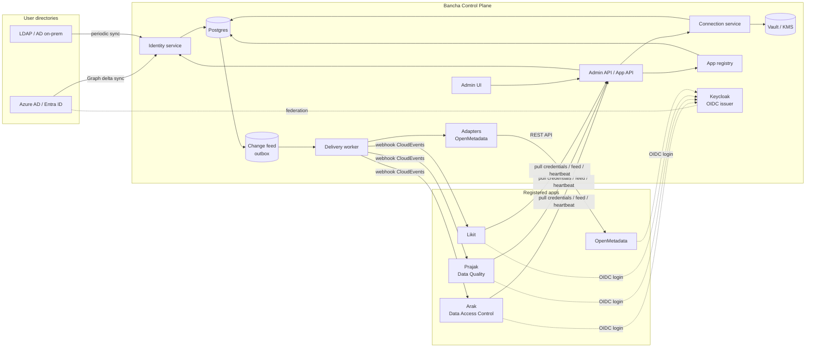
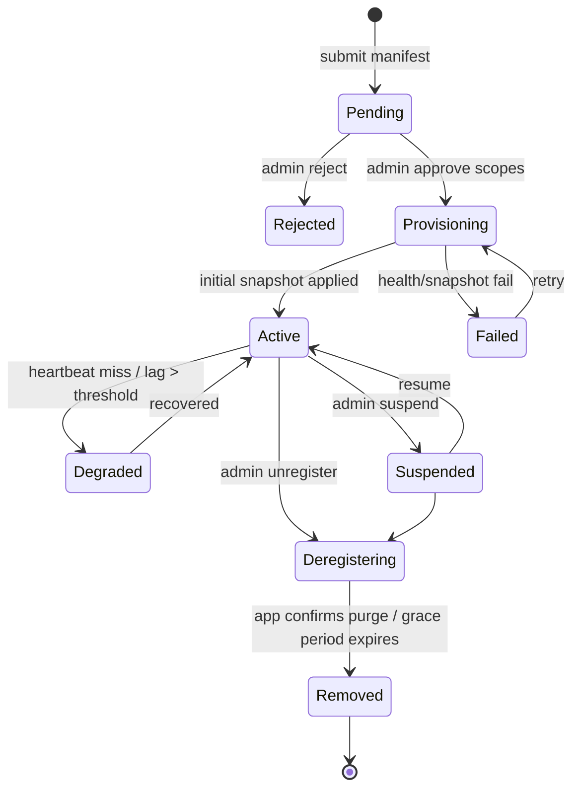
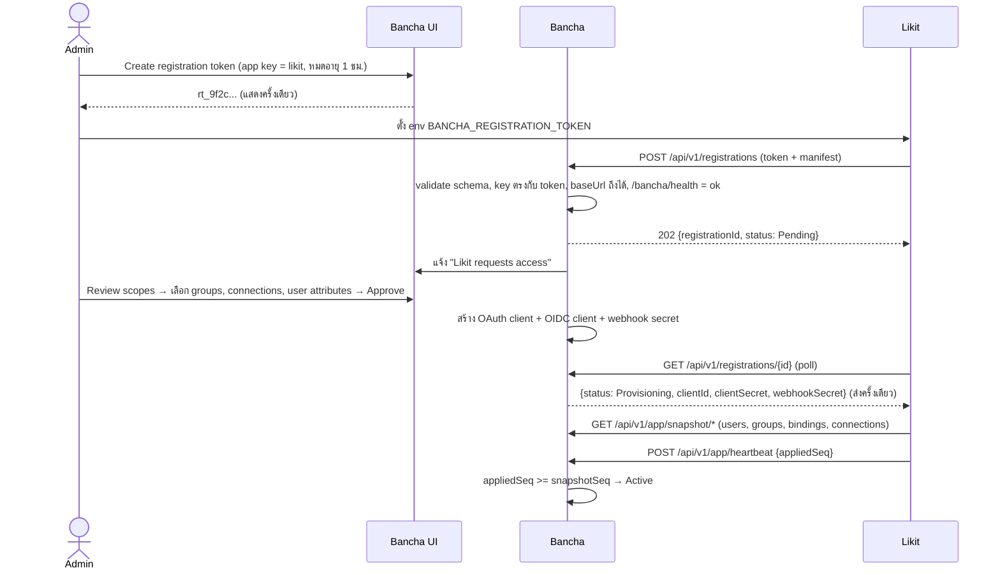

# Bancha — Control Plane สำหรับ Arak · Prajak · Likit · OpenMetadata

> สถานะ: Draft v0.1 · 13 Oct 2026
> Prototype UI: `prototype/control-plane.html`
> Contract: `contracts/` · Database: `db/schema.sql`

---

## 0. สรุปการตัดสินใจหลัก

| # | เรื่อง | ข้อเสนอ | เหตุผล |
|---|---|---|---|
| D1 | ขอบเขตของ Bancha | ดูแลเฉพาะ **control plane** คือ identity, connection, app registry และ config เท่านั้น ส่วนข้อมูลธุรกิจที่แอพแลกกัน (DQ result, policy, lineage) ส่งผ่าน OpenMetadata หรือ API ตรงระหว่างแอพ | ถ้า Bancha ถือ business data ด้วย จะกลายเป็น bottleneck และ single point of failure |
| D2 | Source of truth | Bancha เป็นเจ้าของ **users, groups, role bindings, connections** ส่วนแอพย่อยเก็บแค่ **projection** (สำเนาอ่านอย่างเดียว) | แก้ปัญหาแต่ละแอพมี user table ของตัวเองแล้วข้อมูลไม่ตรงกัน |
| D3 | SSO | Bancha ให้บริการ **OIDC issuer เดียว** (Keycloak อยู่เบื้องหลังในฐานะ identity broker) แล้ว federate ไป Azure AD / LDAP ทุกแอพรวม OpenMetadata ใช้ issuer เดียวกัน | login ครั้งเดียวใช้ได้ทุกแอพ และเพิ่ม directory ใหม่ได้โดยไม่ต้องแก้แอพ |
| D4 | มาตรฐานการ Register | **Bancha App Contract v1** = manifest (`bancha-app.yaml`) + endpoint ที่แอพต้องมี 3 ตัว + OAuth2 client credentials | แอพใหม่ (Likit ฯลฯ) เสียบเข้ามาได้โดยไม่ต้องแก้ Bancha |
| D5 | การกระจายข้อมูล | **Change feed** ที่มี sequence number + **webhook push** (CloudEvents, HMAC-signed) + **snapshot** ไว้ resync | ได้ทั้ง real-time และกู้คืนได้เสมอเมื่อแอพล่ม เพราะไม่ขึ้นกับว่า event ทุกตัวต้องถึงปลายทาง |
| D6 | Secrets | **Push reference, pull secret**: event ส่งไปแค่ metadata ของ connection แอพมาขอ credential เองตอน runtime ด้วย token ของตัวเอง | secret ไม่กระจายไปค้างใน DB ของทุกแอพ และ rotate ได้จากที่เดียว |
| D7 | แอพที่แก้โค้ดไม่ได้ (OpenMetadata) | ใช้ **Adapter** ที่รันฝั่ง Bancha แปลง event เป็นการเรียก REST API ของแอพนั้น | ใช้มาตรฐานเดียวกันได้โดยไม่ต้อง fork OpenMetadata |

---

## 1. ขอบเขต: Control plane กับ Data plane

```
            ┌──────────────── CONTROL PLANE (Bancha) ────────────────┐
            │  ใคร (users/groups)   ต่ออะไร (connections)             │
            │  ใครใช้แอพไหนได้ (role bindings)   แอพไหนมีอยู่ (registry) │
            └────────────────────────────────────────────────────────┘
                      │ config + identity (event / pull)
                      ▼
  ┌────────── DATA PLANE (แต่ละแอพทำงานจริงที่นี่) ───────────────────┐
  │  Arak  ── ออก GRANT/REVOKE บน data source                        │
  │  Prajak ── รัน DQ test แล้วส่งผลไป OpenMetadata                    │
  │  OpenMetadata ── catalog, lineage, tags (hub ของ metadata)        │
  │  Likit ── ...                                                    │
  └──────────────────────────────────────────────────────────────────┘
```

กติกา: ถ้าข้อมูลนั้นตอบคำถามว่า *"ใคร / ต่ออะไร / มีสิทธิ์อะไร / แอพไหน"* ให้อยู่ใน Bancha ถ้าเป็น *ผลลัพธ์จากการทำงาน* ให้อยู่ในแอพหรือ OpenMetadata

ส่วน app-to-app call (เช่น Prajak เรียก Arak API) Bancha ทำหน้าที่ **service registry + token issuer** เท่านั้น ข้อมูลไม่ผ่าน Bancha (ดูหัวข้อ 6.6)

---

## 2. ภาพรวมสถาปัตยกรรม



### Components

| Component | หน้าที่ |
|---|---|
| **Admin UI** | หน้าจอตาม prototype มี 5 ส่วน: Overview, Identity, Connections, Apps, Sync & Audit |
| **Admin API** | REST ที่ UI ใช้ ป้องกันด้วย OIDC และ role `bancha.admin` / `bancha.operator` / `bancha.auditor` |
| **App API** | REST ที่แอพย่อยเรียก ป้องกันด้วย OAuth2 client credentials ที่ออกให้ตอน register |
| **Identity service** | sync จาก directory, จัดการ local users, groups, role bindings |
| **Connection service** | CRUD connection, test, credential profiles, grants, rotation |
| **App registry** | validate manifest, lifecycle state machine, ออก credentials |
| **Change feed (outbox)** | ทุกการเปลี่ยนแปลงเขียนลง `change_log` ใน transaction เดียวกับข้อมูลจริง ได้ `seq` ที่เพิ่มขึ้นเรื่อยๆ |
| **Delivery worker** | อ่าน feed แล้ว fan-out ให้แต่ละแอพตาม scope ที่ได้รับอนุมัติ พร้อม retry และ DLQ |
| **Adapters** | plugin ที่ implement contract แทนแอพที่แก้โค้ดไม่ได้ (เริ่มจาก OpenMetadata) |
| **Keycloak** | OIDC issuer และ broker ไป Azure AD/LDAP Bancha คุมผ่าน Admin API ของ Keycloak ผู้ใช้ไม่ต้องเข้าหน้า Keycloak |
| **Vault / KMS** | เก็บ secret ของ connection (Phase 1 ใช้ envelope encryption ใน Postgres ได้ก่อน) |

---

## 3. Identity (User Management)

### 3.1 โมเดล

```
Directory (Azure AD | LDAP | Local)
   └─ User ──< GroupMembership >── Group
                                      │
App ──< AppRole ──< RoleBinding >─────┘   (subject = group หรือ user)
```

- **User / Group** มี `source_directory_id` และ `external_id` (objectId ของ Azure AD หรือ DN ของ LDAP) แก้ได้เฉพาะ attribute ที่ directory ไม่ได้เป็นเจ้าของ
- **AppRole** มาจาก manifest ของแต่ละแอพ (เช่น `arak.data-owner`) Bancha ไม่ต้องรู้ว่า role นั้นแปลว่าอะไรในแอพ
- **RoleBinding** = (app, role, subject) แนะนำให้ bind ที่ **group** เป็นหลัก แล้วให้ user ได้สิทธิ์ผ่าน membership
- สิทธิ์ละเอียดระดับ data (เช่น policy ของ Arak ว่าใครเห็น column ไหน) **ยังอยู่ใน Arak** Bancha ส่งไปแค่ "ใครคือ data owner ของอะไร"

### 3.2 Directory sync

| Directory | วิธี sync | ความถี่ |
|---|---|---|
| Azure AD / Entra ID | Microsoft Graph **delta query** (`/users/delta`, `/groups/delta`) กรองด้วย group filter เช่น `startsWith(displayName,'DG-')` | ทุก 15 นาที + กดสั่งเองได้ |
| LDAP / AD on-prem | LDAP search ใช้ `uSNChanged` ถ้ามี ไม่มีก็ full compare | ทุก 30 นาที |
| Local | สร้างใน Bancha เอง สำหรับ service account หรือ break-glass admin | — |

User ที่หายจาก directory จะถูก **disable ก่อน** (`status=disabled`) แล้ว hard delete หลัง retention 30 วัน เพื่อไม่ให้ประวัติใน Arak/Prajak ขาด reference

### 3.3 SSO

- ทุกแอพ register เป็น OIDC client ของ Keycloak โดยอัตโนมัติตอน register (redirect URIs มาจาก manifest)
- Token มี claims: `sub` (= Bancha user id), `email`, `groups`, `bancha_roles: {"arak": ["data-owner"], "prajak": ["viewer"]}`
- แอพเช็คสิทธิ์จาก token ได้ทันที ส่วน projection ใน DB แอพมีไว้ทำ lookup และ report (เช่น dropdown เลือก owner)

### 3.4 ส่งข้อมูลส่วนบุคคลเท่าที่จำเป็น (PDPA)

Manifest ประกาศ attribute ที่แอพต้องใช้ (`requires.identity.users.attributes`) แล้ว Bancha **ตัด field อื่นทิ้ง** ก่อนส่ง และกรองเฉพาะ user ใน group ที่อนุมัติให้แอพนั้น ทุก field ที่ส่งออกไปมี audit ว่าส่งให้แอพไหน

### 3.5 ค่าที่ Bancha ส่งให้แต่ละแอพ

ตารางนี้ map จากของจริง: อ่าน arakdb (`principal`, `principal_attribute`, `group_member`, `app_role_assignment`) และ OpenMetadata users API แบบ read-only เมื่อ 14 Oct 2026 ดูของจริงรายคนได้ที่ Identity → Across apps ในคอนโซล

| Field กลาง | ใครกำหนด | Arak เก็บที่ | OpenMetadata เก็บที่ |
|---|---|---|---|
| `id` | Bancha | ยังเก็บไม่ได้: `principal.external_id` มีอยู่แต่ API ของ Arak ไม่ให้ตั้ง จึงผูกด้วย email | custom property `banchaId` |
| `username` | Directory | `principal.username` | `user.name` |
| `email` | Directory | `principal.email` | `user.email` |
| `displayName` | Directory | `principal.display_name` | `user.displayName` |
| `status` | Directory | `principal.enabled` (แก้ได้เฉพาะบัญชี `local`) | soft delete ของ user |
| `department` | Directory | `principal_attribute` key `department` (แถว `source = 'local'`) | ไม่ส่ง |
| `employeeType` | Directory | `principal_attribute` key `employeeType` | ไม่ส่ง |
| `country` | Directory | `principal_attribute` key `country` | ไม่ส่ง |
| `groups` | Bancha | `principal` (type GROUP, `source = 'local'`) + `group_member` | `user.teams` |
| `roles` | Bancha (role binding) | `app_role_assignment.app_role` + `scope_fqn` | `user.roles`, `user.isAdmin` |

Directory หมายถึง Azure AD เมื่อต่อแล้ว ระหว่างนี้ค่าตั้งต้นมาจากที่แอพถืออยู่

**แอพเก็บเอง Bancha ไม่ส่งและไม่เขียนทับ** (ประกาศใน `requires.identity.users.keeps`)

- Arak: `clearance`, `rls_department`, `tenant`, `doctype` ใน `principal_attribute` (เป็น policy ของ Arak), `db_principal_map`, ค่า LLM, rail และ home layout
- OpenMetadata: ownership ของ asset, followers, personas, bot account

**กติกาที่ได้จากข้อมูลจริง**

1. **ผูกด้วย email ไม่เปลี่ยน username** คนเดียวกัน Arak ใช้ username เป็นอีเมล ส่วน OpenMetadata ใช้ชื่อสั้น ถ้าส่ง username กลางค่าเดียวจะเปลี่ยนชื่อบัญชีเดิม Bancha จึงหา account เดิมด้วย `match: email` เก็บ Bancha id ไว้ และส่ง username ที่แอพนั้นใช้อยู่ ส่วน user ใหม่ใช้ username กลาง
2. **Role ส่งทั้ง key และค่าที่แอพใช้** Arak เก็บ `PLATFORM_ADMIN`, `DATA_OWNER`, `REQUESTER`, `AUDITOR` manifest ประกาศ `appValue` ให้แต่ละ role แล้ว event ส่ง `{ "role": "data-owner", "appValue": "DATA_OWNER", "scope": "<fqn>" }` แอพไม่ต้องมี mapping table
3. **Role มี scope ได้** `DATA_OWNER` ผูกกับ FQN ของ OpenMetadata role ที่ manifest ตั้ง `scoped: true` จะมี `scope` ใน role binding
4. **ส่งเฉพาะที่ manifest ขอ** OpenMetadata ขอแค่ `username`, `email`, `displayName` จึงไม่ได้ department หรือ country
5. **Arak ไม่มี source `bancha`** CHECK constraint ของ `principal.source` รับแค่ `entra`, `openmetadata`, `local` ของที่ Bancha สร้างจึงเป็น `local` และแยกออกได้จาก audit (actor `bancha-sync`) ดู §3.6

**Mapping ของ role Arak**

| Bancha role | Arak `app_role` | หมายเหตุ |
|---|---|---|
| `arak.platform-admin` | `PLATFORM_ADMIN` | |
| `arak.data-owner` | `DATA_OWNER` | scoped ด้วย `scope_fqn` |
| `arak.requester` | `REQUESTER` | default |
| `arak.auditor` | `AUDITOR` | |

### 3.6 Bancha push เข้า Arak อย่างไร (ทดสอบบน prod แล้ว 14 Oct 2026)

Arak ไม่ต้องแก้โค้ด Bancha เป็น **adapter** ที่เรียก admin API ของ Arak เอง (`server/arak-push.js`) แต่ละแอพยังเก็บข้อมูลในตารางของตัวเอง Bancha แค่ทำให้ค่าตรงกับส่วนกลาง

- **บัญชี** Bancha login เป็น `bancha-sync` (local SERVICE, `PLATFORM_ADMIN`) สร้างด้วย `server/arak-sync-account.js` รหัสสุ่มเก็บใน `.env` ของ Bancha (mode 600) audit ของ Arak จึงบอกได้ว่า Bancha เป็นคนแก้
- **ใช้งาน** `node server/arak-push.js <desired.json> [--plan|--apply|--undo]` ค่า default คือ `--plan` พิมพ์สิ่งที่จะทำโดยไม่แก้อะไร รันซ้ำได้ ถ้าค่าตรงแล้วจะได้ "Arak already matches"
- **อัตโนมัติ** server ของ Bancha (`server/arak-sync.js`) รัน `--apply` เองตอน start, เมื่อไฟล์ใน `ARAK_SYNC_FILE` (ตอนนี้ `config/arak.json`), `config/connections.json` หรือ manifest เปลี่ยน (เช็คทุก 5 วินาที) และทุกคืนตาม `ARAK_SYNC_AT` (default 02:00) ถ้าล้มเหลวจะลองใหม่ใน 10 นาที ดูผลล่าสุดที่ `GET /api/arak-sync` และรายละเอียดใน `pm2 logs bancha`
- **User** หาด้วย email ก่อน แล้วค่อย username ของ `local` ถ้าไม่มีจะสร้าง USER แบบไม่มีรหัส (login ด้วย Microsoft เท่านั้น) ให้ role ที่ขาด และแทนที่ attribute `department`, `employeeType`, `country` เฉพาะแถว `local` บัญชี `entra` แก้ได้แค่ role และ attribute
- **Group** สร้างเป็น GROUP `local` แล้วเพิ่ม member
- **Connection** ส่งเฉพาะตัวที่ `grants.arak` มี โดยแบ่งเจ้าของ field ดังนี้

| Field | เจ้าของ |
|---|---|
| engine, host, port, database, login (username/password) | Bancha |
| enforcement mode, secure schema/pattern, table scope, `omServiceFqn`, enabled | Arak |

  source ใหม่ถูกสร้างแบบ **disabled และ enforcement `NONE`** ให้ admin ของ Arak เปิดเอง login ถูก seal เป็น `fernet:` ใน Arak และส่งตอนสร้างเท่านั้น ตอนอัปเดตส่ง `fernet:stored` เพื่อเก็บค่าเดิม
  OpenMetadata: Bancha ตั้ง `baseUrl` ส่วน JWT ของ bot ยังมาจาก env `OM_JWT_TOKEN` ของ Arak เพราะ Bancha ถือแค่ password login
- **Undo** `--undo` ถอน role, ลบ attribute ที่ Bancha ใส่, เอาออกจาก group, ปิดบัญชี และลบ source ที่ Bancha สร้าง (เฉพาะที่ disabled และไม่มี asset)

**ข้อจำกัดตอนนี้**

1. API ลบ principal ไม่ได้ จึงทำได้แค่ปิด (`enabled = false`)
2. ตั้ง `external_id` ผ่าน API ไม่ได้ ผูกด้วย email ไปก่อน
3. Role ที่เปลี่ยนมีผลตอน user login ครั้งถัดไป
4. ลบออกจากไฟล์ไม่ได้แปลว่าลบใน Arak push ไม่ prune ถ้าจะถอนต้องรัน `--undo` กับรายการนั้น
5. Admin ของ Arak ยังแก้ค่าที่ Bancha ส่งไปใน UI ได้ Bancha จะเขียนทับรอบถัดไป ถ้าจะล็อก ("Managed by Bancha") ต้องให้ทีม Arak เพิ่ม source หรือ flag

**ผลทดสอบบน prod** สร้าง `bancha-test` (REQUESTER + DATA_OWNER), `bancha-test-group`, source `bancha-test-pg` (connect test ถึง PostgreSQL 16.15) ตรวจใน arakdb แบบ read-only แล้วตรง และ `arak-live-pg` ไม่ถูกแตะ ไฟล์ทดสอบคือ `server/arak-push.test.json`

---

## 4. Connections

### 4.1 ประเภท

| Category | ตัวอย่าง | ใครใช้ |
|---|---|---|
| `data_source` | PostgreSQL, Oracle, SQL Server, Snowflake, Databricks, Trino, BigQuery, Hive | Arak (admin), Prajak (read), OpenMetadata (metadata) |
| `metadata` | OpenMetadata (URL + bot JWT) | Arak, Prajak, Likit, OM adapter |
| `directory` | Azure AD (tenant, client id/secret), LDAP (bind DN) | Identity service ของ Bancha เท่านั้น |

### 4.2 Credential profiles

connection หนึ่งตัวมี credential ได้หลายชุดตามระดับสิทธิ์ แล้ว **grant ให้แอพทีละ profile**

```
Connection: dwh-prod (PostgreSQL 10.6.150.40:5432/dwh)
 ├─ profile "metadata" → user om_reader      → grant: OpenMetadata
 ├─ profile "read"     → user dq_reader      → grant: Prajak
 └─ profile "admin"    → user arak_admin     → grant: Arak
```

Prajak จะได้ credential ของ Arak ไม่ได้ เพราะไม่มี grant ของ profile นั้น (least privilege)

### 4.3 Push reference, pull secret

1. Admin grant `dwh-prod/read` ให้ Prajak
2. Bancha ส่ง event `connection.granted` ไปที่ Prajak โดย payload มีแค่ **id, type, host, port, database, profile และ options** ไม่มี password
3. Prajak เรียก `GET /api/v1/app/connections/{id}/credentials?profile=read` ด้วย access token ของตัวเอง
4. ได้ `{username, password, expiresAt}` กลับมา แล้วเก็บไว้ใน memory ไม่เกิน `expiresAt` **ห้ามเขียนลง DB**
5. เมื่อ rotate Bancha ส่ง `connection.secret.rotated` แอพต้องทิ้ง cache แล้ว pull ใหม่

Phase 3: ถ้าใช้ Vault database secrets engine ก็ออก **dynamic credential** ต่อแอพและหมดอายุเองได้

### 4.4 ส่ง data source ไป OpenMetadata อัตโนมัติ

เมื่อ grant profile `metadata` ให้ OpenMetadata ตัว adapter จะสร้างหรืออัปเดต `DatabaseService` ใน OM ให้เลย ประกาศ data source ที่ Bancha ครั้งเดียว แล้ว catalog ใน OM, DQ ของ Prajak และ access control ของ Arak จะอ้าง **connection id เดียวกัน** ทำให้ map ข้อมูลข้ามแอพได้ตรง

### 4.5 Test และ health

- ปุ่ม **Test** รันจาก Bancha (network path ของ Bancha)
- **Test from app** ส่งคำสั่ง `connection.test.requested` ให้แอพทดสอบจาก network ของแอพเอง แล้วรายงานกลับมา ช่วยจับกรณี firewall เปิดให้ Bancha แต่ไม่เปิดให้แอพ

---

## 5. Bancha App Contract v1 (มาตรฐานการ Register / Unregister)

### 5.1 สิ่งที่แอพต้องมี

| # | ของ | รายละเอียด |
|---|---|---|
| 1 | **Manifest** | `bancha-app.yaml` ตาม schema ใน `contracts/app-manifest.schema.json` และ serve ที่ `GET /.well-known/bancha-app.json` |
| 2 | **Health** | `GET {baseUrl}/bancha/health` → `200 {"status":"ok","version":"2.3.0","appliedSeq":48210}` |
| 3 | **Event receiver** | `POST {baseUrl}/bancha/events` รับ CloudEvents ต้อง verify HMAC signature, idempotent และตอบ `2xx` ภายใน 10 วินาที |
| 4 | **Bootstrap** | ตอน start ถ้ายังไม่มี client credential ให้ใช้ registration token register ตัวเอง (5.3) |

เมื่อ register สำเร็จ แอพได้ 3 อย่าง:
- `client_id` / `client_secret` สำหรับเรียก App API (OAuth2 client credentials)
- `webhook_secret` สำหรับ verify signature ของ event
- OIDC client สำหรับ SSO ซึ่งใช้ `client_id` เดียวกัน

ทีมแอพไม่ต้องเขียนเองทั้งหมด เตรียม **`bancha-sdk`** (Python / Java / Node) ที่ทำ signature verify, dedupe, version check, feed catch-up, credential cache และ heartbeat ไว้ให้แล้ว แอพเขียนแค่ handler ต่อ event type

### 5.2 Lifecycle



| State | ส่ง event? | credential ใช้ได้? | SSO login ได้? |
|---|---|---|---|
| Pending | ไม่ | ไม่ | ไม่ |
| Provisioning | snapshot เท่านั้น | ใช้ได้ | ไม่ |
| Active / Degraded | ส่ง | ใช้ได้ | ได้ |
| Suspended | หยุดส่ง (feed ยังเก็บไว้) | ไม่ได้ | ไม่ได้ |
| Deregistering | ส่ง `app.deregistering` อย่างเดียว | เรียกได้เฉพาะ `deregistration:complete` | ไม่ได้ |
| Removed | — | revoke แล้ว | — |

### 5.3 Register flow

มี 2 ทาง ปลายทางเหมือนกัน

**A. Self-registration (แนะนำ ใช้กับ CI/CD ได้)**: แนวเดียวกับ RFC 7591 Dynamic Client Registration



**B. Manual**: admin ใส่ manifest URL หรือ upload yaml ในหน้า Apps → Register app แล้ว Bancha ส่ง credential ไปให้แอพผ่าน `POST {baseUrl}/bancha/bootstrap` (one-time และ verify ด้วย token ที่ admin ใส่ฝั่งแอพไว้ก่อน)

### 5.4 Unregister flow

1. **Impact analysis** (UI แสดงก่อนกดยืนยัน): role bindings ที่จะหาย, connection grants ที่จะ revoke, แอพอื่นที่ `dependsOn` แอพนี้ (มีแอพพึ่งอยู่จะ block ไว้จนกว่า admin จะ override)
2. Admin พิมพ์ app key เพื่อยืนยัน แล้วเลือก grace period (ค่าเริ่มต้น 24 ชม.)
3. State เป็น `Deregistering` แล้วส่ง `app.deregistering` หยุดส่ง event อื่น และ disable OIDC client ทันที
4. แอพลบ projection และ secret cache แล้วเรียก `POST /api/v1/app/deregistration:complete`
5. Bancha revoke client credentials, webhook secret และ dynamic DB credentials แล้วลบ role bindings และ grants โดย **snapshot ทั้งหมดเก็บลง audit**
6. State เป็น `Removed` แถวใน `apps` ไม่ลบ ถ้า register ใหม่ด้วย key เดิมจะได้ credential ชุดใหม่ และ admin เลือกได้ว่าจะ restore bindings จาก snapshot หรือไม่

### 5.5 Upgrade และเปลี่ยน manifest

- แอพ deploy เวอร์ชันใหม่แล้ว submit manifest ใหม่ผ่าน `PUT /api/v1/app/manifest`
- **ขอ scope ลดลงหรือเท่าเดิม**: apply ทันที
- **ขอ scope เพิ่ม** (attribute ใหม่, connection type ใหม่, event ใหม่): เข้าสถานะ `Pending changes` แอพยังทำงานด้วย scope เดิมจนกว่า admin approve เหมือน permission ของแอพมือถือ
- role ที่ถูกลบออกจาก manifest แต่ยังมี binding อยู่: แสดงเป็น orphan ใน UI ให้ admin จัดการ ไม่ลบเอง

### 5.6 App-to-app call

- Manifest ประกาศ `provides.scopes` (เช่น Arak มี `arak:policies.read`) และ `consumes.scopes` (เช่น Prajak ขอ `arak:policies.read`)
- Admin approve แล้ว Prajak ขอ token ด้วย `client_credentials` + `audience=arak` + `scope=arak:policies.read`
- Prajak หา URL ของ Arak ได้จาก `GET /api/v1/app/services/arak` (service discovery)
- ข้อมูลวิ่งตรงจาก Prajak ไป Arak **ไม่ผ่าน Bancha**

---

## 6. การกระจายข้อมูลไปยังแอพ

### 6.1 หลักการ

1. **Outbox**: การเปลี่ยนแปลงทุกครั้งเขียนลง `change_log` ใน transaction เดียวกับข้อมูลจริง แต่ละแถวได้ `seq` (bigint ที่เพิ่มขึ้นเรื่อยๆ)
2. **State-carrying event**: payload คือ **state ทั้งก้อน** ของ resource พร้อม `version` แอพแค่ upsert ถ้า `version` ใหม่กว่าที่มี ทำให้ idempotent และไม่ต้องสนลำดับที่มาถึง
3. **3 ช่องทาง** ใช้ร่วมกัน:
   - **Push**: webhook ส่งทันที แบบ at-least-once
   - **Feed**: `GET /api/v1/app/feed?after={seq}` ใช้เมื่อแอพเพิ่ง start หรือเจอ seq กระโดด
   - **Snapshot**: `GET /api/v1/app/snapshot/{resource}` สำหรับ resync ทั้งหมด จะได้ `snapshotSeq` ไว้ต่อ feed
4. **Reconciliation**: แอพรายงาน `appliedSeq` ผ่าน heartbeat ทุก 30 วินาที Bancha คำนวณ **lag** ต่อแอพแล้วแสดงใน Overview ทุกคืนเทียบ checksum ของ projection เพื่อจับ drift

แอพที่ไม่อยากเปิด webhook ให้ตั้ง `delivery.mode: poll` แล้วใช้ feed อย่างเดียวได้ (เหมาะกับแอพที่อยู่หลัง firewall)

### 6.2 Event envelope (CloudEvents 1.0)

```http
POST /bancha/events HTTP/1.1
Content-Type: application/cloudevents+json
Bancha-Delivery-Id: dlv_01JA3K7Q8M
Bancha-Signature: t=1760368222,v1=5b0c3e...   # HMAC-SHA256(webhook_secret, t + "." + body)
```

```json
{
  "specversion": "1.0",
  "id": "evt_01JA3K7Q2X",
  "source": "bancha://prod",
  "type": "io.bancha.user.updated",
  "subject": "users/u_7f3c21",
  "time": "2026-10-13T15:10:22Z",
  "datacontenttype": "application/json",
  "banchaseq": 48213,
  "data": {
    "id": "u_7f3c21",
    "version": 12,
    "username": "somchai.p",
    "email": "somchai.p@example.co.th",
    "displayName": "Somchai Prasert",
    "department": "Data Governance",
    "status": "active",
    "groups": ["g_dg_stewards", "g_finance_analysts"],
    "roles": [
      { "role": "data-owner", "appValue": "DATA_OWNER", "scope": "arakdb.public.orders" }
    ]
  }
}
```

แอพต้อง reject ถ้า `t` ห่างจากเวลาปัจจุบันเกิน 5 นาที (กัน replay)

### 6.3 Event catalog

| Domain | Types | หมายเหตุ |
|---|---|---|
| Identity | `user.created` `user.updated` `user.disabled` `user.deleted` | กรอง attribute ตาม scope |
| | `group.created` `group.updated` `group.deleted` | |
| | `group.membership.changed` | ส่งรายชื่อสมาชิกทั้งหมดของ group (state-carrying) |
| Access | `rolebinding.granted` `rolebinding.revoked` | เฉพาะ role ของแอพนั้น |
| Connection | `connection.granted` `connection.updated` `connection.revoked` `connection.secret.rotated` `connection.test.requested` | ไม่มี secret ใน payload |
| Lifecycle | `app.activated` `app.suspended` `app.deregistering` `app.scopes.changed` | |
| Sync | `sync.resync.requested` | สั่งให้แอพทำ snapshot ใหม่ |

แอพ publish event ของตัวเองไว้ใน `events.publish` ของ manifest ได้ (เช่น `arak.access.granted`) Bancha **เก็บไว้ใน audit** เพื่อแสดง timeline รวม แต่ไม่ forward ต่อ (แอพอื่นที่อยากได้ให้ใช้ OpenMetadata หรือ API ตรง)

### 6.4 Delivery guarantees

| เรื่อง | ค่า |
|---|---|
| Semantics | at-least-once แอพ dedupe ด้วย `id` และกันข้อมูลเก่าด้วย `version` |
| Timeout | 10 วินาที |
| Retry | 30s, 2m, 10m, 30m, 1h, 3h, 6h, 12h (8 ครั้ง, exponential + jitter) |
| หลัง retry หมด | เข้า **dead letter** แสดงในหน้า Sync & Audit กด Retry หรือสั่ง resync ได้ |
| Ordering | ไม่ guarantee ข้าม resource ใช้ `version` แทน ภายใน subject เดียวกัน worker ส่งทีละตัว |
| Circuit breaker | ล้มติดกัน 20 ครั้ง ให้พัก 5 นาที แล้วแอพเป็น `Degraded` |

### 6.5 เมื่อไรต้องเพิ่ม Kafka / NATS

Phase 1–2 ใช้ outbox ใน Postgres + worker ก็พอ (หลักพัน event ต่อชั่วโมง) ถ้ามีแอพเกิน ~10 ตัว หรือ event เกินหลักแสนต่อชั่วโมง ค่อยให้ worker publish ลง Kafka แล้ว delivery worker ต่อแอพ consume เอง **contract ฝั่งแอพไม่ต้องเปลี่ยน**

---

## 7. OpenMetadata Adapter

OpenMetadata มี user, team และ role ของตัวเอง แต่ไม่ได้ implement Bancha contract จึงใช้ adapter ที่รันใน Bancha

| Bancha event | OpenMetadata API |
|---|---|
| `user.created/updated` | `PUT /api/v1/users` (match ด้วย email) |
| `user.disabled/deleted` | `DELETE /api/v1/users/{id}` (soft delete) |
| `group.*` | `PUT /api/v1/teams` (teamType = `Group`) |
| `group.membership.changed` | `PATCH /api/v1/teams/{id}` (users) |
| `rolebinding.*` (role `om.data-steward`, `om.data-consumer`) | assign `defaultRoles` ของ team / user |
| `connection.granted` (profile `metadata`) | `PUT /api/v1/services/databaseServices` |
| `connection.revoked` | ปิด ingestion pipeline (ไม่ลบ service เพื่อเก็บประวัติ catalog) |

- Credential ของ adapter คือ connection category `metadata` (OM URL + bot JWT)
- OM ตั้ง SSO แบบ `customOidc` ชี้ไปที่ Keycloak ของ Bancha
- Adapter รายงาน `appliedSeq` และ health เหมือนแอพทั่วไป จึงขึ้นใน Overview และ sync matrix เหมือนกัน
- รูปแบบนี้ใช้ซ้ำกับแอพ third-party อื่นในอนาคตได้ ถ้าแอพนั้นรองรับ SCIM 2.0 อยู่แล้ว ใช้ adapter `scim` ตัวกลางตัวเดียวพอ

---

## 8. Security

| เรื่อง | มาตรการ |
|---|---|
| App → Bancha | OAuth2 client credentials, access token อายุ 5 นาที, scope จำกัดตามที่อนุมัติ, เปิด mTLS ได้ถ้าอยู่ใน network เดียวกัน |
| Bancha → App | HMAC-SHA256 signature + timestamp, rotate `webhook_secret` ได้โดยมีช่วงที่ secret เก่าและใหม่ใช้ได้พร้อมกัน 24 ชม. |
| Secrets at rest | Vault (KV v2 หรือ database engine) หรือ Phase 1 ใช้ AES-256-GCM envelope encryption โดย KEK อยู่ใน KMS หรือ HSM ส่วน DB เก็บแค่ `secret_ref` |
| Secrets in transit | ไม่อยู่ใน event, ไม่อยู่ใน log, credential endpoint ต้องเป็น TLS เท่านั้น และทุกครั้งที่เรียกมี audit |
| Admin RBAC | `bancha.admin` (ทุกอย่าง), `bancha.operator` (sync, retry, test), `bancha.auditor` (อ่านอย่างเดียว) การกระทำที่อันตราย (unregister, ลบ connection, rotate) ใช้ four-eyes approval เป็น option |
| Audit | append-only table และส่งต่อ SIEM ได้ บันทึก actor, action, target, before/after (ปิดบัง secret), IP, request id |
| PDPA | attribute minimization ต่อแอพ (3.4), retention ของ user ที่ disabled, export รายงาน "ข้อมูลของ user X อยู่ในแอพไหนบ้าง" ได้จาก `app_sync_state` |

---

## 9. Data model

ดู `db/schema.sql` ตารางหลัก:

- `directories`, `users`, `groups`, `group_members`
- `apps`, `app_manifests` (มี history), `app_roles`, `app_credentials`, `registration_tokens`
- `role_bindings`
- `connections`, `credential_profiles`, `connection_grants`
- `change_log` (outbox/feed), `deliveries`, `app_sync_state`
- `audit_log`

---

## 10. API summary

### Admin API (ใช้โดย UI, OIDC + admin roles)

```
GET/POST        /api/v1/admin/users            PATCH/DELETE /users/{id}
GET/POST        /api/v1/admin/groups           PUT /groups/{id}/members
GET/POST        /api/v1/admin/directories      POST /directories/{id}:sync
GET/POST        /api/v1/admin/role-bindings    DELETE /role-bindings/{id}
GET/POST        /api/v1/admin/connections      POST /connections/{id}:test
                                               POST /connections/{id}:rotate
PUT/DELETE      /api/v1/admin/connections/{id}/grants/{appKey}
GET             /api/v1/admin/apps             GET /apps/{key}/impact
POST            /api/v1/admin/registration-tokens
POST            /api/v1/admin/apps/{key}:approve | :reject | :suspend | :resume | :resync
DELETE          /api/v1/admin/apps/{key}?graceHours=24
GET             /api/v1/admin/deliveries       POST /deliveries/{id}:retry
GET             /api/v1/admin/audit
```

### App API (ใช้โดยแอพย่อย, client credentials)

```
POST /api/v1/registrations                     (registration token)
GET  /api/v1/registrations/{id}
GET  /api/v1/app/me
PUT  /api/v1/app/manifest
POST /api/v1/app/heartbeat                     {version, appliedSeq, status}
GET  /api/v1/app/feed?after=48210&limit=500
GET  /api/v1/app/snapshot/{users|groups|role-bindings|connections}?cursor=
GET  /api/v1/app/connections/{id}/credentials?profile=read
POST /api/v1/app/connections/{id}/test-results
GET  /api/v1/app/services/{appKey}
POST /api/v1/app/deregistration:complete
```

### App ต้อง expose

```
GET  /.well-known/bancha-app.json
GET  /bancha/health
POST /bancha/events
```

---

## 11. Observability

- Metrics (Prometheus): `bancha_feed_seq`, `bancha_app_applied_seq{app}`, `bancha_app_lag{app}`, `bancha_delivery_total{app,status}`, `bancha_delivery_latency_seconds`, `bancha_directory_sync_duration_seconds`, `bancha_connection_test_status{connection}`
- Alert: lag > 500 นานเกิน 10 นาที, dead letter > 0, directory sync fail 3 ครั้งติด, connection test fail, secret อายุเกินนโยบาย rotation
- Trace: แนบ `traceparent` ไปกับ webhook ให้ไล่ข้ามแอพได้

---

## 12. Migration ของแอพที่มีอยู่ (Arak, Prajak)

หลักคือ **ไม่ทำให้แอพที่ใช้อยู่พัง** ทุกขั้นถอยกลับได้ และแอพเป็นคนเลือกว่าจะเริ่มรับเมื่อไร

| ขั้น | Bancha ทำ | แอพทำ | ถ้าต้องถอย |
|---|---|---|---|
| 0 · Shadow (ทำแล้ว) | อ่าน user ของแต่ละแอพแบบ read-only, จับคู่ด้วย email, แสดงพรีวิว event ที่จะส่ง | ไม่ต้องทำอะไร | ไม่มีอะไรให้ถอย |
| 1 · Link | จับคู่บัญชีด้วย email | Arak: ยังไม่ต้องทำ (API ตั้ง `external_id` ไม่ได้ จึงใช้ email เป็น key) | ไม่มีอะไรให้ถอย |
| 2 · Upsert (Arak ทำได้แล้ว §3.6) | push ผ่าน admin API ของ Arak ด้วย `bancha-sync` | ไม่ต้องแก้โค้ด ของที่สร้างเป็นแถว `local` | หยุด push หรือรัน `--undo` แอพยังใช้ข้อมูลเดิมได้ |
| 3 · Cut over | เป็นเจ้าของ field ใน §3.5 | ปิดการแก้ field เหล่านั้นใน UI ของแอพ (แสดง "Managed by Bancha") Arak ต้องเพิ่ม source หรือ flag ก่อน | เปิดการแก้ในแอพกลับ |

ลำดับเดิม:

1. เพิ่มคอลัมน์ `bancha_id` ใน user และ group table ของแอพ
2. Bancha import user จาก Azure AD แล้วรัน **matching report** โดย map ด้วย email แสดง user ที่ match ไม่ได้ให้ admin จัดการ
3. แอพ register แล้วรับ snapshot มาเติม `bancha_id`
4. ปิดการสร้างและแก้ user ใน UI ของแอพ (แสดง "Managed by Bancha")
5. ย้าย connection config จาก DB ของแอพมา Bancha แล้วเปลี่ยนให้แอพอ้าง `connection_id` ของ Bancha
6. เปิด SSO ผ่าน Keycloak แล้วค่อยปิด login เดิม

---

## 13. Roadmap

| Phase | ขอบเขต | ผลลัพธ์ |
|---|---|---|
| **1 · Foundation** | App registry + manifest validation, Local + Azure AD sync, groups, role bindings, connections (encrypted in DB), outbox + webhook + feed, Arak integration ผ่าน SDK | Arak ใช้ user, group และ connection จาก Bancha |
| **2 · Federation** | Keycloak SSO, Prajak integration, OpenMetadata adapter, sync matrix และ dead letter UI, registration token flow | 3 แอพ login ครั้งเดียวและ sync ครบ |
| **3 · Hardening** | Vault dynamic credentials, app-to-app tokens, Likit, SCIM adapter, four-eyes approval, drift checksum | พร้อมรับแอพที่ 5 ขึ้นไป |

---

## 14. คำถามที่ต้องตัดสินใจร่วมกัน

1. ใช้ **Keycloak** เป็น OIDC broker ได้ไหม หรือองค์กรอยากให้ทุกแอพชี้ Azure AD ตรง (ถ้าชี้ตรง จะรองรับ LDAP และ local user ยากขึ้น)
2. มี **Vault** อยู่แล้วหรือไม่ ถ้าไม่มี Phase 1 จะใช้ envelope encryption ใน Postgres ก่อน
3. Environment (Dev/UAT/Prod) แยกเป็น **Bancha คนละ instance** (แนะนำ) หรือ instance เดียวที่มี field `environment`
4. Arak และ Prajak เขียนด้วยภาษาอะไร จะได้เลือกทำ SDK ภาษานั้นก่อน
5. Likit คือแอพอะไร ต้องใช้ resource ประเภทใดจาก Bancha
6. `clearance` และ `rls_department` ของ Arak ควรมาจากส่วนกลาง (Bancha หรือ Azure AD) ไหม หรือเป็น policy ที่ Arak ตัดสินเองต่อไป (ตอนนี้ออกแบบให้ Arak เก็บเอง)
7. User ส่วนใหญ่ใน Arak ตอนนี้เป็นบัญชี demo (`@example.test`) จะ link หรือปล่อยเป็น `local` แล้วค่อยลบ
8. OpenMetadata ใช้ role อะไรเป็นค่า default ของ user ที่ Bancha สร้าง และ `isAdmin` ควรมาจาก role binding ไหน
